# SE-Resnet18 Transfer Learning MATLAB Code for Transfer Bearing Fault Diagnosis under Different Working Conditions, Using XiChu University Bearing Data as an Example

Summary
This issue employs MATLAB to develop the SE-Resnet18 network for fault diagnosis on data from Xi'an Jiaotong University. The residual and SE modules of the trained SE-Resnet18 model under condition 0 will be frozen, while only fine-tuning the fully connected layers is performed, achieving transfer learning under conditions 1, 2, and 3. The final experimental results are as follows:
Under condition 0, 800 samples are used for training and 400 samples are used for testing. The diagnostic accuracy is 100%.
When migrating the model from Condition 0 to Condition 1, only a small sample (10 samples for each fault) is used for fine-tuning the fully connected layer, with training speeds of only a few seconds. The diagnostic accuracy on the test set (1100 samples) is 99.72%.
When migrating the model from condition 0 to condition 2, only a small sample (10 samples for each fault) is used for fine-tuning the fully connected layer, and the training speed is only a few seconds. The diagnostic accuracy on the test set (1100 samples) is 99.2%.
When migrating the model from condition 0 to condition 3, only a small sample (10 samples for each fault) is used for fine-tuning the fully connected layer, and the training speed is only a few seconds. The diagnostic accuracy of the test set (1100 samples) is 99.10%.
This issue's code will take you through the entire process of transfer learning.
SE mechanism paper: https://arxiv.org/abs/1709.01507
1. SE-ResNet Introduction
In recent years, various attention mechanisms have emerged, combining them with various deep learning models. These models exhibit enhanced feature extraction capabilities compared to conventional deep learning networks, while also reducing the parameter count of the network and enhancing its generalization capability.
SE-ResNet (Squeeze-and-Excitation ResNet) is an improved version of ResNet, incorporating the Squeeze-and-Excitation (SE) module to enhance network performance. The SE module reweights channels, allowing the network to adaptively focus on the importance of different channels. The advantages of SE-ResNet include:  
Enhanced feature representation capability: By modeling the importance of feature channels, the SE module can increase the network's sensitivity to important features, thereby enhancing feature representation capabilities.  
Less computational overhead: Although the introduction of the SE module introduces additional computation, its design is relatively simple, resulting in a smaller computational overhead compared to other parts of the network and often leads to significant performance improvements.  
Easy integration: The SE module can be seamlessly integrated with existing network architectures (such as ResNet, Inception, etc.), improving network performance without the need for redesigning the entire network architecture.  
The following diagram illustrates the application of the SE module in the ResNet module as presented in the original paper.
\n        \n  
The SEmodule is applied to the residual branch of the Resnet module. To better explain why the SE module can enhance the generalization capability of the Resnet network, here is a more vivid diagram attached.
\n        \n      Original Resnet network (left side), after two 3x3 convolutions, directly adds the results of the previous step's pooling or convolution.
In the SE-Resnet structure (right side of the figure), the feature dimensions after two convolutions are first subjected to global pooling. Subsequently, they pass through two fully connected layers. The key lies in these two fully connected layers: the first one reduces the feature dimension down to 1/r of the input, followed by ReLU activation and then reverts back to the original dimension through the second fully connected layer. This approach has several advantages over using a single fully connected layer: ① It introduces more nonlinearity, which can better model the complex correlations across channels; ② It significantly reduces both the number of parameters and computational load. Finally, a Sigmoid gate is used to obtain normalized weights between [0, 1].Finally, through a Scale operation (i.e., multiplying corresponding channels), the normalized weights are weighted onto each channel's feature. This essentially calibrates the weights for each channel, focusing attention on the channels with higher weights. It's undeniably impressive!
2. MATLAB Implementation of SE-ResNet
This code will implement the SE mechanism in MATLAB and stitch it into the Resnet18 network. Take a look at the network result graph, on the left is the structure diagram of the SE-ResNET module, on the right is the network structure implemented in MATLAB, perfectly achieves one-to-one correspondence!
\n        \n  
The core code is as follows: Here, we demonstrate how to integrate the SE module.
% Then, you need to connect the SE block properly\nSEblockName = '2a';\necaLayers = SEBlock(64,16,SEblockName); % Example parameters\nlgraph = addLayers(lgraph, ecaLayers);\nlgraph = disconnectLayers(lgraph, 'bn2a_branch2b', 'res2a/in1');\nlgraph = connectLayers(lgraph, 'bn2a_branch2b', ['se_global_pool_',SEblockName]);\nmul = multiplicationLayer(2,'Name',['scale_',SEblockName]);\nlgraph = addLayers(lgraph, mul);\nlgraph = connectLayers(lgraph, 'bn2a_branch2b', ['scale_',SEblockName,'/in1']);\nlgraph = connectLayers(lgraph, ['se_sigmoid_',SEblockName],['scale_',SEblockName,'/in2']);\nlgraph = connectLayers(lgraph, ['scale_',SEblockName], 'res2a/in1');\n  
3. Implementing transfer learning for bearing fault diagnosis based on the SE-Resnet model under different working conditions
Experimental steps are as follows:
Step 1: Process data from Xichu University under different working conditions. Details of the Xichu University data are as follows:
\n        \n  
The motor load in the second column is divided into four working conditions: 0, 1, 2, and 3. Here, only the four working conditions when the fault diameter is 0.1778, 0.3556, and 0.5334mm are considered. The data for these four working conditions is processed as follows:

Partial overlap sampling method is adopted, which means collecting samples from the original signal with partial overlap between adjacent samples. Each sample consists of 2048 data points from the original time-domain signal. To ensure that each data point can be collected, there will be 1048 overlapping data points between adjacent samples, with a sliding window step size of 1000. Finally, each working condition contains 10 types of faults, each type containing 120 samples.

The code organization for the first step is shown in the screenshot below, resulting in four files: Working condition0.mat, Working condition1.mat, Working condition2.mat, and Working condition3.mat, representing working conditions 0, 1, 2, and 3 respectively.
\n        \n  
Step 2: Continuous Wavelet Transform (CWT) of the time-frequency plots from the first step's data:
The four different working conditions obtained in the first step are extracted for wavelet transformation simultaneously. The images extracted are placed in the corresponding "Working Condition x Continuous Wavelet Transform Video Plot" folder. Subsequently, the images are compressed. This compression is done to save time for subsequent model training. The code screenshot is as follows:
\n        \n  
Step Three: Model Training and Transfer Learning under Different Working Conditions.
Firstly, the SE-Resnet18 network is used to train and test data from condition 0. The first 80 samples of each group of faults are selected for training, while the last 40 samples are tested. The results are as follows:
\n        \n  
The t-SNE dimensionality reduction plots before and after model identification are as follows:
\n        \n  
The residual and SE modules of the SEResnet18 model trained under condition 0 were frozen, and the full connection layers of the model were fine-tuned using small sample data (only 10 sets of samples for each type of fault) under conditions 1, 2, and 3. The remaining 1100 samples (110 sets for each type of fault) were used for testing. The test results are as follows:
\n        \n  
The same operation, the SEResnet18 model trained under condition 0 is transferred to conditions 2 and 3, and the test results are as follows:
\n        \n      \n        \n  
The code directory for the third step is as follows:
\n        \n  

## Images

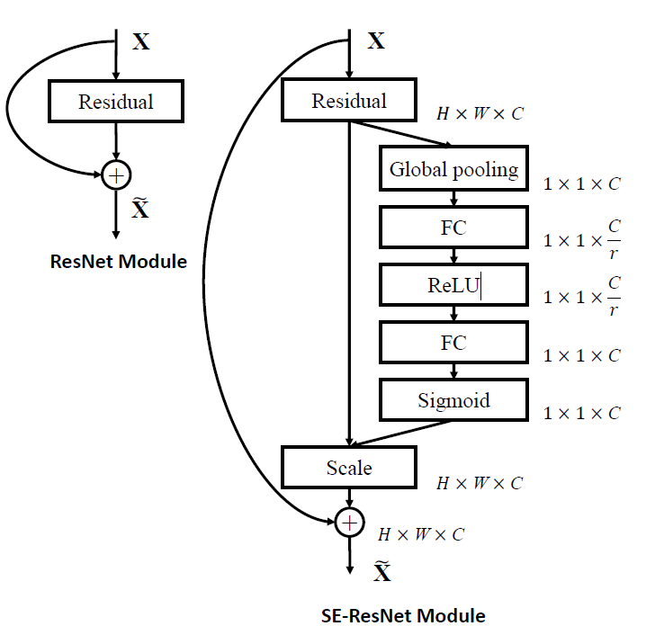
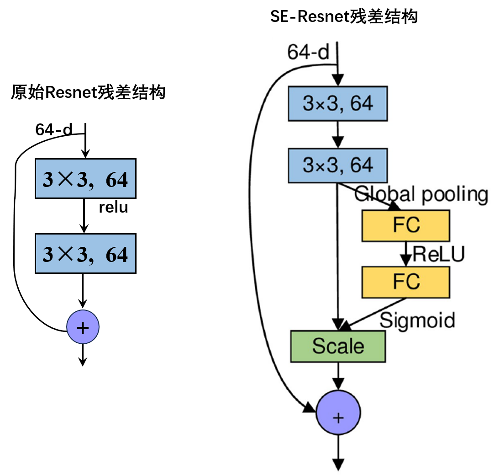
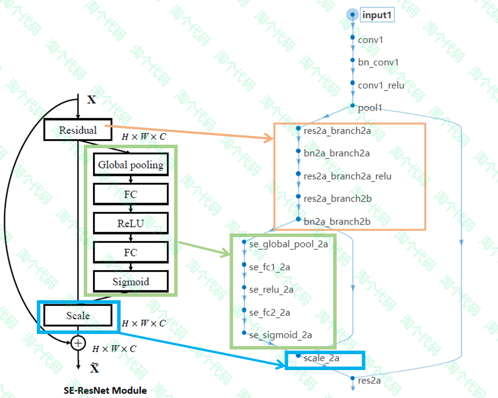
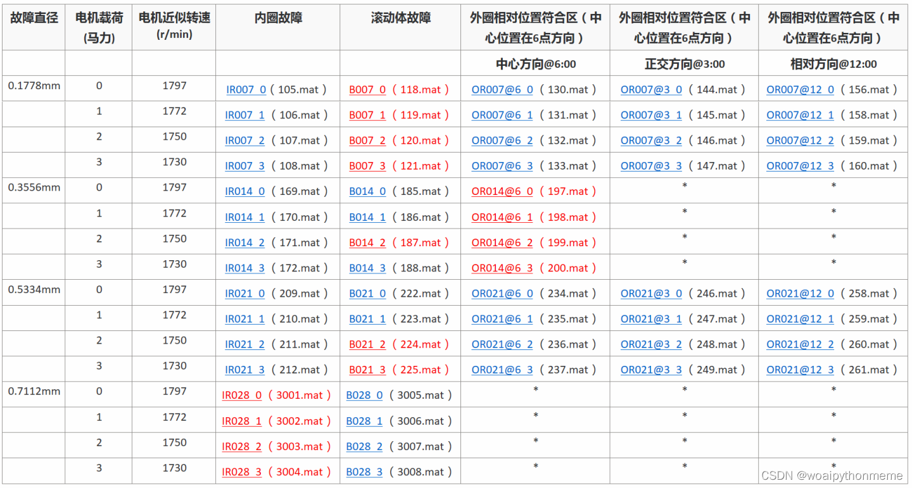
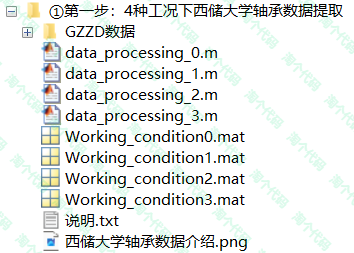
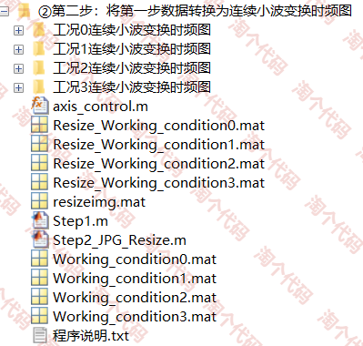
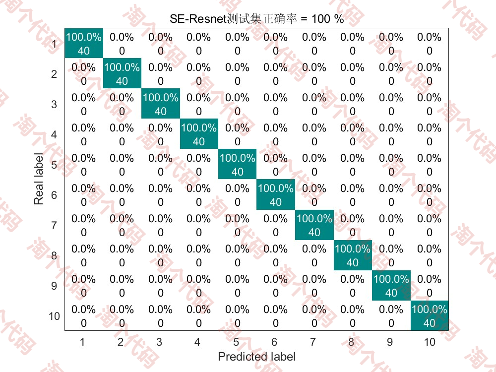
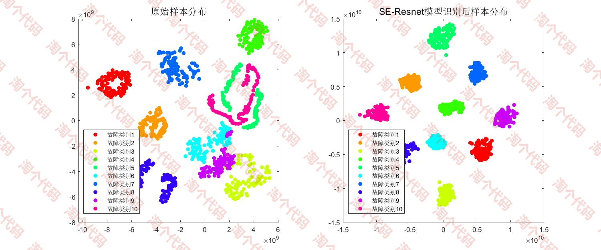
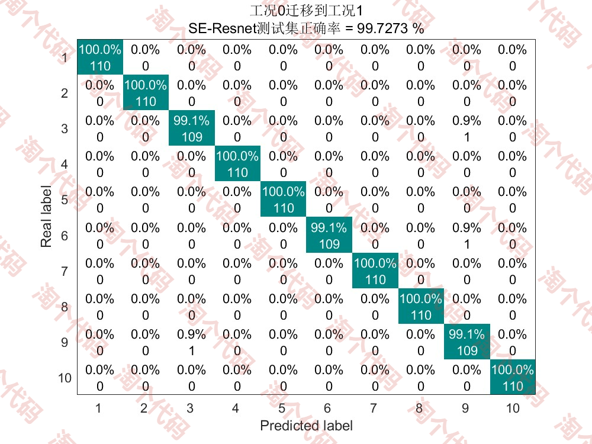

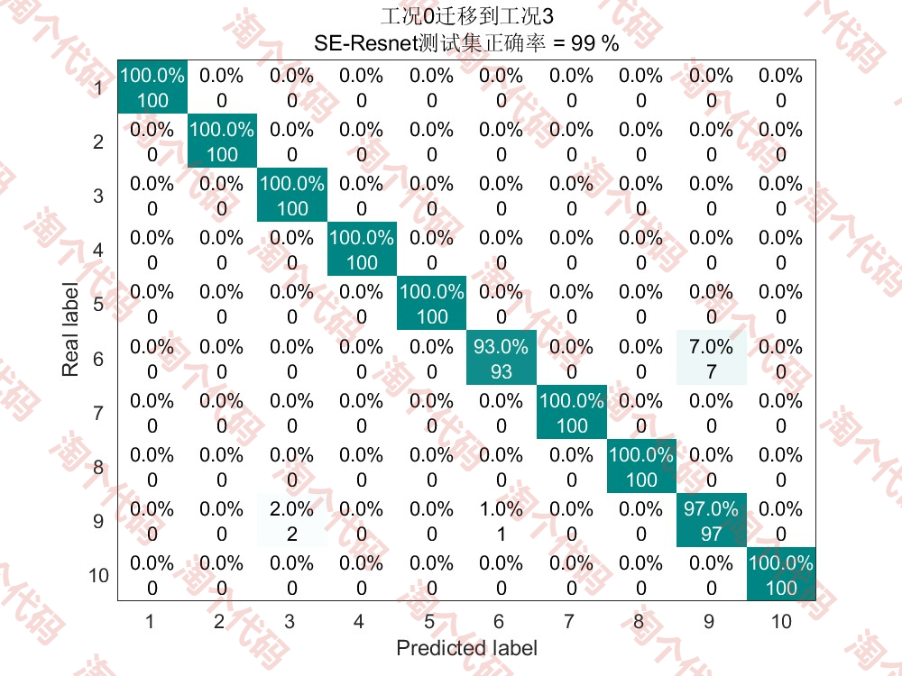
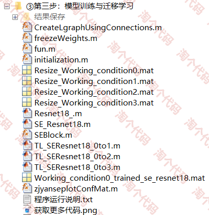

<!-- PAYMENT_BLOCK -->

## Get this dataset

- Payment link (Stripe): [Buy now](https://buy.stripe.com/3cs8yP7sY87d0vu9AB)
- Payment QR code: 

<!-- /PAYMENT_BLOCK -->
